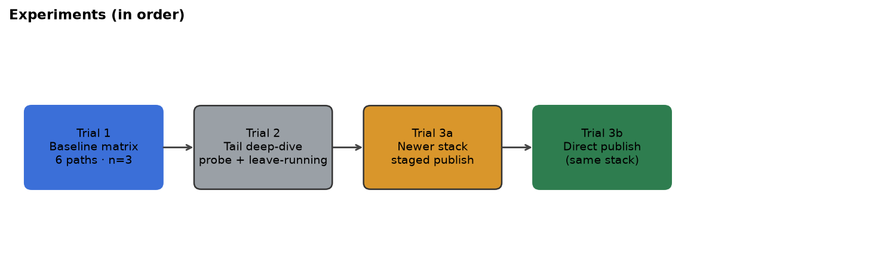
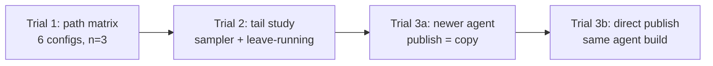
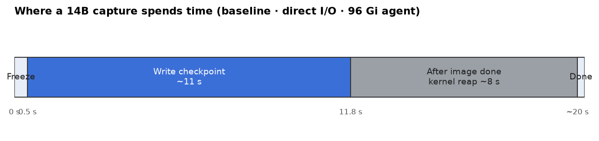
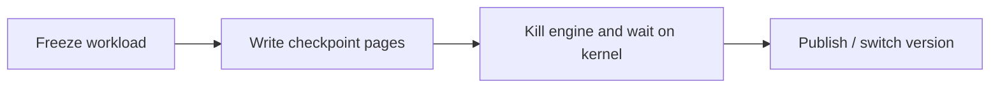

# CRIU capture latency: where the time goes

Summary of local runs on one GPU node with vLLM (Qwen3). The goal is to map **where capture seconds go** and **what may be worth optimizing**, without selecting a single “best” storage setup.

**Issue:** Reduce scale-dependent CRIU capture latency.

---

## At a glance (14B model)

| Measurement | Result |
|---|---|
| Typical capture on the fast baseline path | **~19.5 s** (median of 3 runs) |
| Time writing the checkpoint image | **~11 s** |
| Time after the image is finished | **~8 s** (unchanged across disk / I/O settings in the matrix) |
| That tail vs checkpoint size | **~0.15 s per GB** across 0.6B–14B |
| Skip killing the engine (diagnostic only) | Tail **8 s → 0 s**, total capture **20 s → 11 s** |
| Newer agent, staged copy to disk | **~58 s** total (**~19 s** copy after CRIU) |
| Same stack, write checkpoint directly on PVC | **~24 s** total (copy **~0 s**) |

Restore (pod ready again) was **~36 s** on the baseline path and **~25–27 s** on the newer stack. Capture is the focus; restore is included only for scale comparison.

---

## Experiments in order

**Agent builds (plain language)**

| Label | What changed |
|---|---|
| **Baseline** | Original snapshot agent used for Trial 1 |
| **Baseline + diagnostic** | Same agent, one-off test that does not kill the engine after dump |
| **Newer stack** | Upgraded operator, agent, and PageBroker to current upstream main |
| **Newer + direct publish** | Small agent change so capture writes on the PVC and commits with a rename (no big copy step) |

Storage toggles (**Trial 1 only**): direct vs buffered I/O, PageBroker on/off, agent memory 4 Gi vs 96 Gi.

---

## What one capture looks like

| Term | Meaning |
|---|---|
| Capture total | Wall clock for the checkpoint the operator reports |
| CRIU dump window | Time the agent spends inside the CRIU dump call |
| Write phase | Until the image on disk is essentially complete |
| Post-write tail | After the image is done, before CRIU finishes |
| Publish | Making the new checkpoint visible (rename or copy) |

---

## Trial 1: path matrix (baseline agent)

**Models:** Qwen3 0.6B and 14B · **Repeats:** 3 per arm

Six combinations of I/O mode, PageBroker, and agent memory were exercised on the same node and PVC.

| Path | 14B capture | Write | Tail | Extra publish | 14B restore |
|---|---:|---:|---:|---:|---:|
| **Direct I/O, 96 Gi agent** | **19.5 s** | 10.8 s | 8.7 s | (rename) | 36 s |
| Direct, 4 Gi agent | 20.2 s | 11.2 s | 8.8 s | (rename) | — |
| Buffered I/O, 96 Gi | 22.6 s | 13.8 s | 8.6 s | (rename) | 36 s |
| Buffered, 4 Gi | 31.8 s | 22.8 s | 8.8 s | (rename) | — |
| PageBroker + direct | 35.4 s | 26.6 s | 8.8 s | 20 s | 64 s |
| PageBroker + buffered | 35.5 s | 26.4 s | 8.7 s | 20 s | 63 s |

**Takeaways**

- The **~8 s tail** showed up on every arm that did not use PageBroker staging. Disk tuning did not move it.
- **Direct I/O at ~4.7 GB/s** on this PVC; agent memory did not matter much for direct.
- **Buffered I/O** slowed down a lot with only **4 Gi** on the agent pod.
- **PageBroker** added a long staging write plus **~20 s** to publish; capture and restore both got slower.

### Tail vs model size

Tail length tracks image size (~0.15 s/GB). That fits “cost of tearing down a big process” more than “slow disk.”

---

## Trial 2: what is the tail?

**Sampler run** (14B, same baseline path as above):

During the tail, CRIU was idle on CPU while the kernel sat in `wait4` on the engine (zombie, heavy RSS). Nothing useful showed up in CRIU logs between “image done” and “stats written.”

**Leave-running diagnostic** (engine not killed after dump):

| | Normal kill | Leave running |
|---|---:|---:|
| Tail | 7.96 s | 0.01 s |
| CRIU dump window | 19.77 s | 11.42 s |

Same bytes written either way. The **~8 s** gap aligns with **kill + kernel reap**, not extra disk I/O.

---

## Trial 3: newer agent stack

**Model:** 14B · **3b:** **n=3** on **`e73a6112-direct`**

Same node and workload. Compare to baseline **direct I/O, 96 Gi** from Trial 1.

| Step | CRIU dump | Publish | Capture total | Restore |
|---|---:|---:|---:|---:|
| Baseline (Trial 1 median) | 19.5 s | rename | ~19.5 s | 36 s |
| **3a** Newer stack, staged publish (n=1) | 34.8 s | 18.8 s copy | **57.7 s** | 27 s |
| **3b** Direct publish (n=3 median) | **20.5 s** | **~2 ms** | **24 s** | **~24 s** |

**3b spread:** capture **24–25 s**; `criu_dump` **20.2–20.8 s**; publish **~2 ms** on all three runs.

**Tail on newer stack (n=1 sampler):** write finished ~**12 s** into CRIU; **`do_wait` ~8 s** after that (same post-write window as baseline).

---

## What looks worth optimizing

### 1. Post-write reap (~8 s at 14B on the baseline path)

**Problem:** CRIU is already done writing the checkpoint file (~11 s), but the agent still waits ~8 s inside the dump before capture finishes. In logs this is the gap between “image complete” and CRIU writing stats. The same ~8 s tail appeared on every baseline arm without PageBroker staging, independent of direct vs buffered I/O and agent memory limit. It grows about **0.15 s per GB** of checkpoint size.

**What is going on:** During that window CRIU is not doing useful CPU work on the image. The engine was killed after dump and the kernel is finishing teardown (`wait4` on the process). A one-off test that skipped the kill removed almost all of this gap while writing the same bytes at the same rate, so this time is not “slow disk.”

**What could be optimized:** Treat “checkpoint bytes are on the PVC” separately from “engine is fully reaped.” If a snapshot can be marked ready when the image is durable, user-facing capture need not wait on `wait4`. That is a lifecycle/contract change, not a tuning knob. Longer term, anything that avoids kill-and-wait on supported paths would attack the same cost (the leave-running run was only a diagnostic, not a shipping mode).

### 2. Staged publish copy (~19–20 s at 14B)

**Problem:** After CRIU returns, the stack sometimes copies the entire checkpoint from a temporary location to the PVC before flipping to the new version. That copy showed up as **~20 s** with PageBroker on the baseline agent and **~19 s** on one run with the newer agent’s default staged prepare.

**What is going on:** The copy is plain data movement, not CRIU getting slower. Total capture became **~35 s** (broker + copy on baseline) or **~58 s** (newer agent + copy) even when the CRIU write itself was similar to the fast path.

**What could be optimized:** Write the checkpoint where it will live (direct I/O to the PVC, or prepare beside the final path and commit with a rename). Trial **3b** cut publish to ~0 s and total capture to **~24 s** in one 14B run versus **~58 s** with copy. Defaulting to direct prepare on large checkpoints is the concrete fix prototyped in Trial **3b**.

### 3. Buffered I/O on a small agent (~9 s extra at 14B vs direct)

**Problem:** With buffered (page-cache) I/O and only **4 Gi** on the agent pod, 14B capture was **~32 s** versus **~20 s** on direct I/O with the same PVC. Most of the gap is a slower write phase, not the post-write tail.

**What is going on:** The agent pod does not have enough RAM to cache large writeback traffic efficiently, so the kernel keeps flushing and the effective write rate drops (~2.2 GB/s vs ~4.7 GB/s direct on the test node).

**What could be optimized:** Direct I/O is preferable for large checkpoints; writeback requires sufficient agent memory. Writeback should not be paired with a tiny agent memory limit on large models.

### 4. CUDA checkpoint prep (~3 s at 14B)

**Problem:** Before CRIU runs, the agent freezes GPU/CUDA state. That step was about **3 s** at 14B on baseline and about **2.6 s** on one newer-stack run.

**What is going on:** Real work, but smaller than the post-write reap and the image write on the baseline path, and much smaller than a staged publish copy when that path is enabled.

**What could be optimized:** Worth tracking, but likely second priority until reap and publish paths are addressed. Any CUDA-side improvements would shave seconds, not tens of seconds.

---

## Caveats

- Trial 1 and **3b:** **n=3**; **3a** and tail sampler on newer stack: **n=1** each.
- Leave-running is **not** a supported production mode; it only isolates the tail.
- Raw JSON and logs live under `benchmarks/results/` on the machine that ran the tests (not all checked into git).

---

## Repo

Report and plots: `benchmarks/results/capture-latency-report/` on branch `exp/criu-capture-latency` ([fork](https://github.com/sheetal104/snapshot/tree/exp/criu-capture-latency/benchmarks/results/capture-latency-report)).
