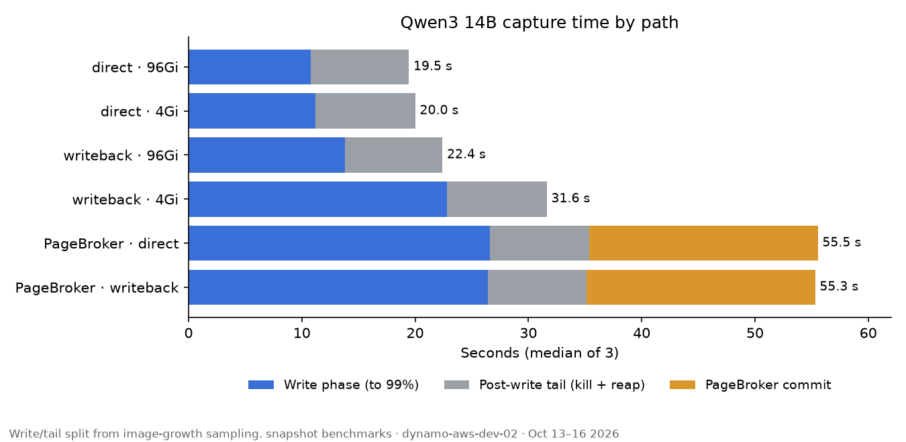
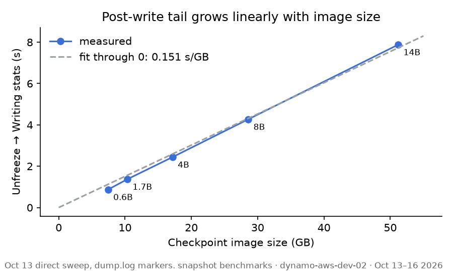
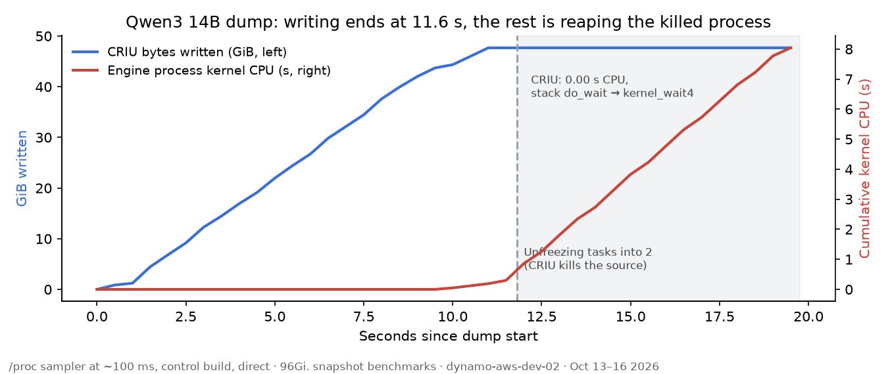
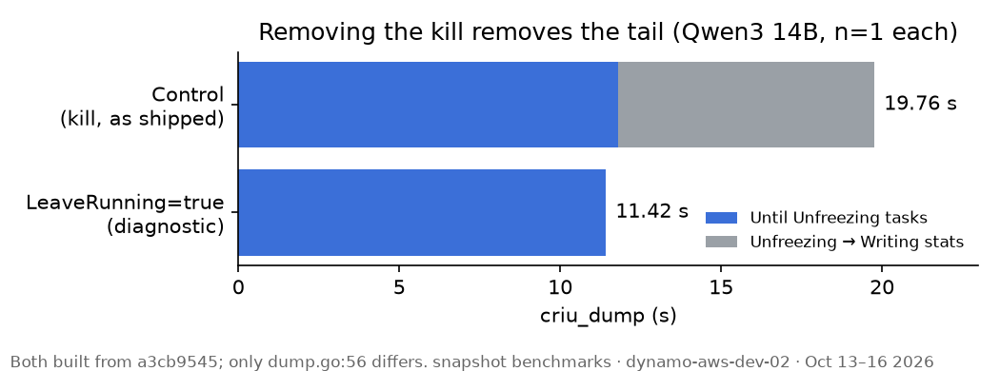

# Scale-dependent CRIU capture latency: where the time goes

**Summary (capture).** Exploration notes for discussion around *scale-dependent CRIU capture latency* — not a sign-off or priority call. One vLLM workload on one node.

On **State A** · **direct · 96 Gi** (baseline agent, PageBroker off), 14B **`criu_dump`** median **~19.5 s** (n=3): **~11 s** image write, **~8 s** after the image is complete. That post-write window looks like kernel reap (`wait4`); it did not move with storage toggles in the matrix and scaled ~**0.15 s/GB** with model size. **State A†** (same stack, diagnostic `LeaveRunning`) dropped **`criu_dump` from 19.77 s to 11.42 s** with the same bytes — the gap matches the post-write window.

**State B** (upgrade to upstream main, stock agent) still **staged publish** on capture: one 14B run at **57.7 s** checkpoint total (**~19 s** copy). **State C** (B + direct checkpoint prepare) was **24.2 s** in one run (publish ~1 ms); **`criu_dump` ~21 s** remained. Tail not remeasured on B/C.

| Headline | Value |
|---|---|
| 14B post-write tail, kill vs leave-running (A vs A†) | 7.96 s → 0.01 s |
| 14B `criu_dump`, kill vs leave-running | 19.77 s → 11.42 s |
| Tail vs checkpoint size (State A) | ~0.15 s/GB |
| 14B checkpoint total, B vs C | 57.7 s → 24.2 s (n=1 each) |
| 14B writeback penalty, 4 Gi vs 96 Gi agent (State A) | +~9 s vs direct |

---

## 1. Context and aim

Local exploration tied to *Reduce scale-dependent CRIU capture latency*: map **capture** time under several **agent states** and **config toggles**, share observations — not pick a shipping plan.

**Questions**
- Which dump phases scale with model size?
- Do `imageIoMode`, PageBroker, or agent memory change those phases?
- What is the ~8 s post-write tail that storage did not move?

**Hypothesis (§6).** Tail = CRIU blocked on kernel teardown of the killed engine, not leftover image I/O.

## 2. Setup

| Item | Value |
|---|---|
| Cluster | `dynamo-aws-dev-02` → vCluster `shsriram-dev`, GPU node `ip-100-66-183-52` |
| Workload | `vllm/vllm-openai:v0.27.1-ubuntu2404` (digest-pinned), `max_model_len=2048`, `gpu_memory_utilization=0.50` |
| Benchmark | `snapshot_benchmarks run`, namespace `shsriram-dev`, PVC `snapshot-pvc` |
| Models | Qwen3 0.6B / 14B (path matrix); 0.6B–14B sweep (tail vs size) |
| Repeats | State **A** matrix: **3** per arm; B/C and diagnostics: **1** unless noted |
| Held fixed | `autoDedup` off, `lazyPages` off; `LeaveRunning` false except **A†** |

### Agent states (read this first)

Each state is the previous row plus one increment. **Config toggles** in §4 apply only inside **State A**.

| State | Increment (from previous) | Deployed stack | Capture publish path | Report sections | Agent git | Branch / commit (traceability) |
|---|---|---|---|---|---|---|
| **A** | *Initial baseline* | Helm `snapshot-0.1.0`, agent tag `v0.1.0` (built from **`a3cb9545`**) | Staged / broker path per config; matrix **direct** writes O_DIRECT to PVC | §4–§7 | `a3cb9545` | `feat/capture-timing-breakdown` |
| **A†** | Diagnostic: `LeaveRunning=true` in `dump.go` (one-off binary, same as A otherwise) | Same as A | Same as A | §6 only | `a3cb9545` | Local build, not deployed |
| **B** | Upgrade operator + agent + PageBroker to **`e73a6112`** (matched images, Helm rev 5) | PageBroker **mandatory**; `restoreMode: direct`, `imageIoMode: direct`, agent **96 Gi** | **`PrepareCheckpoint`** → staged copy to PVC | §9 | `e73a6112` | `origin/main` at upgrade |
| **C** | Agent calls **`PrepareDirectCheckpoint`** (write beside PVC, commit = rename) | Same as B; image tag **`e73a6112-direct`** | Direct prepare (no publish copy) | §9 | `e73a6112` + patch | `exp/criu-capture-latency` · `485f2671` |

Example benchmark run IDs: **B** → `94e8c6e09e71`; **C** → `0ce4d248b731`. Result dirs under `benchmarks/results/20261014-*` … `20261016-*` (A), `20261019-*` (B/C; JSON gitignored except this report).

### Config toggles (State A matrix only)

| Toggle | Values | Where | Effect |
|---|---|---|---|
| `imageIoMode` | direct, writeback | ConfigMap | O_DIRECT vs buffered page cache |
| PageBroker | off, on | config + pod annotation `nvidia.com/snapshot-pagebroker=true` | Stage in memory emptyDir, then publish |
| Agent memory | 4 Gi, 96 Gi | DaemonSet limit | Page-cache headroom for writeback |

## 3. How to read the results

Timeline (**State A · direct · 96 Gi**, 14B), from `dump.log`:

```
0 s           0.46 s                                     11.80 s                      19.76 s
|-- freeze --|============ page write (O_DIRECT) ==========|---- kill -> wait4 reap ----|
```

| Metric | Meaning |
|---|---|
| `criu_dump` | Agent wall time for CRIU dump RPC |
| Write phase | Time to 99% of final image size (sampler) |
| Post-write tail | Image complete → `Writing stats` in `dump.log` |
| Publish | `remove_old_version_and_switch` — copy (B) or rename (A direct, C) |
| Restore total | Pod Ready after restore (compare to capture scale only) |

## 4. State A — path matrix (capture vs restore)



Medians of **three runs** (2026-10-14 – 2026-10-16).

| Arm (toggles) | 0.6B criu | 14B criu | 14B write | 14B rate | 14B tail | 14B commit | 14B restore |
|---|---:|---:|---:|---:|---:|---:|---:|
| **direct · 96 Gi** | 4.72 s | **19.50 s** | 10.8 s | 4.74 GB/s | 8.65 s | rename | 36 s |
| direct · 4 Gi | 5.20 s | 20.18 s | 11.2 s | 4.57 GB/s | 8.81 s | rename | — |
| writeback · 96 Gi | 4.77 s | 22.58 s | 13.8 s | 3.71 GB/s | 8.61 s | rename | 36 s |
| writeback · 4 Gi | 8.12 s | 31.80 s | 22.8 s | 2.24 GB/s | 8.82 s | rename | — |
| PageBroker · direct | 7.01 s | 35.36 s | 26.6 s | 1.92 GB/s | 8.76 s | 20.2 s | 64 s |
| PageBroker · writeback | 7.01 s | 35.50 s | 26.4 s | 1.94 GB/s | 8.72 s | 20.2 s | 63 s |

`14B criu` = capture; `14B restore` = pod Ready (includes vLLM wake). Restore on 4 Gi arms omitted (old flow). Tail ~8 s on all non-broker arms in `dump.log`.

## 5. Trends (State A)



- Post-write tail **~8.6–8.8 s at 14B**, ~**0.15 s/GB** — unchanged across direct / writeback / broker-on arms.
- **Direct ~4.7 GB/s** at 14B regardless of 4 vs 96 Gi agent limit.
- **Writeback** needs memory: 2.24 GB/s (4 Gi) vs 3.71 GB/s (96 Gi).
- **PageBroker on**: slower staging write + **~20 s** publish; 14B capture **~35 s**, restore **~64 s** vs direct **~20 s / ~36 s**.

## 6. Post-write tail (State A, probe + A†)

Sampler during 14B dump (**State A · direct · 96 Gi**):



- CRIU: **0 CPU** in tail; stack `do_wait → kernel_wait4`.
- Engine: zombie, **~7.3–7.7 s** kernel CPU on one core (~47 GiB RSS).
- No `dump.log` lines between last unseize and `Writing stats`.

**A† vs A** (14B, direct, 96 Gi):



| | A (control) | A† (`LeaveRunning`) |
|---|---:|---:|
| Tail (`dump.log`) | 7.96 s | 0.01 s |
| `criu_dump` | 19.77 s | 11.42 s |

Control matched §4 median (**19.50 s**). A† is diagnostic only, not a product mode.

## 7. Measurement fixes (State A era)

| Issue | Fix |
|---|---|
| 4 Gi vs 96 Gi mixed across arms | Reran writeback at 96 Gi |
| PageBroker arm missing annotation | Benchmark annotates pods |
| `exec` without `container=` on agent pod | Fixed in `run.py` |
| PageBroker restore helper | Rebuilt `ns-bind-mount` for A stack |

## 8. Capture phases — discussion table

Restore column in §4 is for scale comparison only.

| Phase / effect | ~14B where seen | Read | Possible direction |
|---|---|---|---|
| Post-write reap | A matrix; §6 | After image done; A† removes most of gap | Decouple snapshot ready from `wait4`? |
| Staged publish copy | A broker commit ~20 s; **B** ~19 s | Not CRIU bandwidth | **C** pattern (`PrepareDirectCheckpoint`) |
| O_DIRECT write | A · direct · 96 Gi ~11 s | ~4.7 GB/s on this PVC | Smaller image or faster storage |
| `cuda_checkpoint` | A ~3 s; C ~2.6 s | Smaller than reap + write | Secondary |
| Writeback + 4 Gi | A §4 | Page-cache pressure | Size agent or default direct |

GPU at **0 MiB** before freeze in explore probe — reap blocks **snapshot ready**, not necessarily next GPU job.

## 9. States B and C (upstream upgrade + direct prepare)

Same node and workload as §2. Compare to **A · direct · 96 Gi** (§4 median).

| Phase | A · direct · 96 Gi (n=3) | B (n=1) | C (n=1) |
|---|---:|---:|---:|
| `cuda_checkpoint` | ~3.5 s | 3.6 s | 2.6 s |
| `criu_dump` | 19.5 s | 34.8 s (wrote staging) | 21.2 s (beside PVC) |
| Publish | rename | 18.8 s copy | ~1 ms rename |
| Checkpoint total | — | 57.7 s | 24.2 s |
| Restore (pod Ready) | 36 s | 27 s | 25 s |

**B → C** is only the capture prepare path; operator/PageBroker revision stays on **`e73a6112`**. After C, **`criu_dump` still ~21 s** in our run — write + likely reap still dominate. Tail sampler not re-run on B/C.

## 10. Follow-ups to discuss

- Reap vs snapshot readiness under CUDA / operator lifecycle.
- Upstream **C**-style direct prepare vs other publish designs.
- Defaults for `imageIoMode` and agent memory on large checkpoints.
- More runs: **C** at 14B (n≥3); tail probe on **B** or **C** vs §6.

## 11. Caveats

- **A†** isolates the post-write window; not supported production behavior.
- Tail / A†: n=1; large delta vs matrix spread on `criu_dump`.
- **A** matrix n=3; **B** and **C** n=1 each.
- Explore logs: `benchmarks/results/explore-probe/` (local).

---

**Data.** `benchmarks/results/` date prefixes above; `tail-probe/`, `leaverunning-*`, `ARM.txt` per arm where present. Plots: `uv run --no-project --with matplotlib python make_plots.py`.
